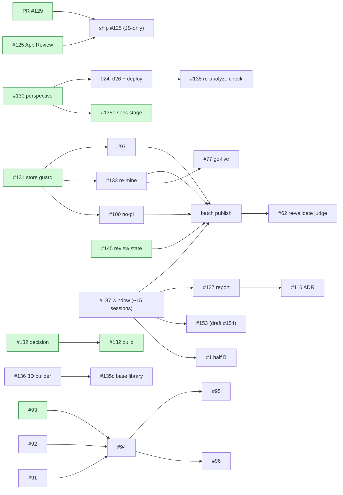

# Backlog plan — milestones and parallel workstreams

_Planned 2026-11-04 from every open issue (28) and open PR (1) in `srjt/flowlog`.
**Status updated 2026-11-07.** Re-plan when a milestone's exit criteria are met or a
decision below changes._

## Status at 2026-11-07

**The code side of M1 and M2 is done, and two M3 items and the M4 split-out were
pulled forward.** What's left is mostly deploys, device work and mining on the Mac,
plus everything behind the #137 measurement window.

### Done (merged to `master`)

| item | PR | notes |
| --- | --- | --- |
| #125 App Review 2.5.19 | #140 | Review bench web-only; route inventory + test; `docs/APP_REVIEW.md`; OTA rule |
| Fingerprint excludes `.gitignore` | #129 | Builds ≤ 30 still list `.gitignore` in `fingerprint:compare` |
| #131 canonical store + publish guard | #143 | Refuses below 90% of live; `--partial-publish "<reason>"` |
| #145 publish never writes review state | #147 | Found during #131; must precede any publish after votes |
| #130 Extraction perspective on the Session | #142 | Migration **024** |
| #93 Smoothcomp research | #141 | No public API; ToS unread (the proxy blocked the site) |
| #1 half A: recurring Weakness → Trends + digest Leak | #146 | Coaching input (half B) waits for the window |
| #135 phase a: force-diagram core modules | #144 | Pure, no UI, no dependency |
| #135 phase b: cue→spec stage | #149 | Migration **025**; inert until phase c (empty base library) |
| #132 operator verdicts | #152 | Migration **026**; story 12 (queue ordering) is a follow-up |
| Pipeline version defined once | #151 | Found during #135 b; supersedes #150 (closed) |

#1 and #135 were auto-closed by mistake: the PR text "does not close #N" counts as a
closing keyword. Both are reopened, with what's left recorded on each.

### Waiting on you

1. **Deploy, in this order:**
   1. `npx supabase migration list`, which should show 024, 025 and 026 as local only;
   2. `npx supabase db push`, then check the new columns and `cue_verdicts`;
   3. **only then** `npx supabase functions deploy process-session`. It writes the
      new columns on every Session, so deploying it first makes every write fail.
2. **Ship the app:**
   - `npx eas-cli fingerprint:compare --build-id <build 30>`. If only `.gitignore`
     differs, an OTA to `testflight` is safe.
   - The App Store submission needs a new build that contains #140.
   - App Store Connect: create the demo account and paste the Notes for Review from
     `docs/APP_REVIEW.md`.
3. **#138** (Re-analyze on a real Session, including the declined case), **after** the
   function is deployed. One exercise also checks perspective (024) and the diagram
   columns (025) on both Re-analyze paths.
4. **On the Mac:**
   - verify the #143 guard (`publish.sh --which-store`, `--dry-run`, and a dry run
     against the stale store, which should refuse);
   - then mine #97, #133 and #100 **to dry-run only** (freeze).
5. **#148** (Supabase keep-alive): add the `SUPABASE_URL` / `SUPABASE_ANON_KEY` repo
   secrets, then merge.
6. **Competition Stats:** send the #92 outreach; grill #91.
7. **Keep recording.** #137 needs ~15 Sessions since #124.

### Parked behind the #137 window

| item | state | when the window closes |
| --- | --- | --- |
| #153 abstain grounding for non-positional mistakes | **Draft PR #154**: migration **027**, `pipeline_version` 1.4.0 | Mark it ready, merge, then 027 before `functions deploy` |
| #1 half B: Weakness → coaching `dominantWeakness` | not started | Build; bump `pipeline_version` |
| Batch publish of #97, #133 and #100 | needs the Mac dry-runs first | One `flowlog-publish` run, leak scan extended to Gordon Ryan series |
| #137 report | needs ~15 Sessions | Model per attempt, fallbacks, restatement rate, length vs 22/25 |

## Who can do what

The backlog splits by **where the work can physically run**, not just by topic:

| owner | can do | cannot do |
| --- | --- | --- |
| **Cloud agent** | code + tests + docs in this repo, web research | reach the local review stores (`~/flowlog-records*`), the instructionals, the frozen baseline, Gemini mining credit, production Supabase |
| **Mac agent** | mining, dry-run publishes, judge runs, production queries — anything needing the local stores or credit | interactive Apple auth, a real recording |
| **You** | decisions, real recordings on device, deploys (`supabase db push`, `functions deploy`, OTA/EAS), sending outreach, recruiting reviewers, merging | — |

## Constraints that shape the order

1. **The Pro-model measurement window (#137) is the pacing item.** It needs ~15 real
   Sessions (~a month at the current ~14/30 days). The findings log (#139) shows
   that every wrong conclusion so far came from measuring two changes at once. So,
   **during the window, nothing changes the coaching path**: no prompt, grounding
   selection or model changes, and no live corpus publishes. Mining and dry-runs
   carry on, and the publish waits until the window closes. Everything merged so far
   is safe inside the window: none of it changes a Cue. #135 b is inert, and #151
   only fixes a label.
2. ~~**#131 comes before any publish.**~~ Done (#143), and #145 (#147) is merged too,
   so the publish path is safe for after votes exist.
3. **Re-mine before reviewers vote.** #133 re-mints the ids that votes attach to.
   At zero votes that costs nothing; after go-live it costs reviewers' work. So the
   order is #133 → #77 go-live.
4. **Migration numbers are taken in merge order, never reserved ahead.**
   `supabase db push` refuses a migration whose number sorts below one already
   applied (without `--include-all`), so a reserved gap becomes a trap.
   Assigned: `024` = #130 (#142) · `025` = #135 b (#149) · `026` = #132 (#152) ·
   `027` = #153 (draft #154). Two open branches that both add a migration: the second
   to merge renumbers.
5. **Hot files:** `supabase/functions/process-session/index.ts` and
   `src/pipeline/FlowlogPipeline.ts`. Only one open PR should change them at a time;
   today that's #154.
6. **Shipping stays JS-only** (no `app.json` version bump), except where a native
   dependency forces a build. `react-native-svg` for #135's `CueDiagram` is the next
   one.
7. **`feat/cue-image-generation` has no merge base with `master`**, and it carries
   the retired generative code (#10 decision 9). Never merge it. #135 a ported the
   prototype by copying files.
8. **PR text never says "does not close #N"**, or "fix" / "resolve" followed by an
   issue number, unless it really closes it. GitHub reads the keyword whatever comes
   before it. Write "Part of #N".

## Milestones

✅ done · ⏸ parked behind the #137 window · everything else is open.

### M1 — Ship-safe foundations

| issue | what | owner | state |
| --- | --- | --- | --- |
| #125 | App Review 2.5.19 | Cloud agent | ✅ #140; shipping is yours (see Waiting on you) |
| PR #129 | Exclude `.gitignore` from the native fingerprint | You | ✅ merged |
| #131 | Publish guard + canonical store as config | Cloud → Mac agent | ✅ #143; Mac verification open |
| #130 | Persist Extraction perspective (024) | Cloud agent → You | ✅ #142; apply 024 + deploy open |
| #137 | Measurement window open; keep recording | You | in progress |
| #93 | Smoothcomp research | Cloud agent | ✅ #141 |
| #92 | Send the jiujitsu.net outreach | You | open |
| #1 | Triage | You | ✅ option 2 (Decisions) |

**Exit:** all code merged ✅. Still needed: 024 applied, `process-session` deployed,
and #125 shipped.

### M2 — Prove it in production _(runs inside the #137 window)_

| issue | what | owner | state |
| --- | --- | --- | --- |
| #138 | Re-analyze exercise on a real Session | You (+ agent reads rows) | open; after deploy |
| #97 | Mine 3 GFF volumes | Mac agent | open; unblocked |
| #133 | Snapshot, then re-mine the unscoped-absolute volumes | Mac agent | open; unblocked |
| #100 | Mine 7 Gordon Ryan no-gi titles | Mac agent | open; unblocked |
| #1 | Half A: Weakness → Trends + digest Leak | Cloud agent | ✅ #146 |
| #132 | Decide verdict storage | You | ✅ server-only table; built early (#152) |
| #91 | Positioning grill | You | open |

All mining in M2 stops at **dry-run publish**, leak check clean, staged in the
canonical store.

**Exit:** #138 closed or its defects ticketed; #97, #133 and #100 staged and dry-run
clean; the #137 window has reached ~15 Sessions.

### M3 — Corpus refresh + certification go-live _(window closed)_

| issue | what | owner | state |
| --- | --- | --- | --- |
| #137 | Report and a recommendation on the cap | Mac agent + You | ⏸ |
| #145 | Publish never resets vote-derived review state | Cloud agent | ✅ #147 (pulled forward) |
| — | One batch publish of #97, #133 and #100 | Mac agent | ⏸ |
| #77 | Go-live: recruit black belts, first real votes, verify live | You | open; after #133 |
| #132 | Build operator verdicts | Cloud agent | ✅ #152 (pulled forward); story 12 is a follow-up |
| #1 | Half B: Weakness → coaching `dominantWeakness`, version bump | Cloud agent | ⏸ |

**Exit:** the corpus is published; at least one record is certified by real votes;
#137 is closed with a recommendation.

### M4 — Grounding & judging upgrades _(needs M3's clean baseline)_

| issue | what | owner | state |
| --- | --- | --- | --- |
| #153 (#116 split) | Abstain from grounding when the mistake isn't about a position | Cloud agent | ⏸ draft #154 is built |
| #116 | ADR for semantic retrieval, once the lexical baseline on 1.2.0+ has accumulated | You + agent | open |
| #62 | Re-validate the judge against the expanded corpus; gate only if it clears ≥12/17 and ≤2/11 | Mac agent | open; after the batch publish |

#153's design changed from the plan. The plan said "one condition on
`target_position_id`", but grounding runs **before** coaching resolves the target,
so that signal doesn't exist yet. See Decision 5.

## Long-running tracks _(independent of M1–M4)_

**Cue visualization (map #10)**

| issue | what | state |
| --- | --- | --- |
| #136 | BJJ 3D Position Builder prototype (separate Vite + Three.js project) | open; can start any time |
| #135 a | Grammar / keypoints / validator / renderer / spec helpers in `src/visualization/` | ✅ #144 |
| #135 b | Post-gate spec stage, client + edge, migration 025 | ✅ #149 (inert: empty base library, so `no_base` and no model call) |
| #135 c | Certified base library (~20 positions) in `src/sports/bjj/` | blocked on #136 |
| #135 | `CueDiagram` component | waits for a native build (`react-native-svg`) |
| #15, #24, #25 | Parked; #24 and #25 are largely superseded by the 3D direction | revisit or close after #136 |

**Competition Stats discovery (map #90).** Decisions only, no code:
#93 ✅ (#141) ∥ #92 (you) ∥ #91 (grill) → #94 data-source strategy → #95 stats/UI
prototype ∥ #96 identity-linking prototype. #141 recommends a hybrid: manual entry
for everyone, jiujitsu.net once licensed, and Smoothcomp only with a written
agreement.

## Workstreams at a glance

| workstream | M1 | M2 | M3 | M4 |
| --- | --- | --- | --- | --- |
| Release | ✅ #125, ✅ #129 · ship open | — | — | — |
| Pipeline integrity | ✅ #130 · deploy open | #138 | — | — |
| Corpus | ✅ #131 | #97 → #133 → #100 (staged) | ✅ #145 · batch publish ⏸ | — |
| Coaching quality | #137 window open | ✅ #132 decision | #137 report ⏸ · ✅ #132 build | #153 ⏸ · #116 ADR · #62 |
| Certification | — | — | #77 go-live | — |
| Product | ✅ #1 decision | ✅ #1 half A | #1 half B ⏸ | — |
| Cue visualization | ✅ #135 a · #136 | ✅ #135 b | — | #135 c (if #136 lands) |
| Competition Stats | ✅ #93 · #92 | #91 | #94 | #95, #96 |

## Decisions

_Settled 2026-11-04:_

1. **The coaching path is frozen during the #137 window**, including live corpus
   publishes: mine and dry-run during the window, then publish once at close. Cost
   accepted: #133 and #100 reach production about a month later.
2. **#1 is option 2**: compute the recurring Weakness client-side in
   `computeTrends`, in two halves. Half A (Trends + digest Leak) merged in #146.
   Half B (coaching input) waits until the window closes, because it changes the
   coaching prompt.
3. **#132 verdicts live in a server-only table**, locked down like `session_prompts`
   (merged as migration 026). A verdict judges a Cue: it stores a snapshot of the
   cue text, never just the Session.
4. **Each issue gets one branch and one PR**, so each lands and deploys on its own.

_Settled since:_

5. **#153 (the #116 split):** Extraction reports `mistakeConcerns` (`position |
   submission | transition | unknown`). Grounding abstains on `submission` and
   `transition`, with its own outcome, `not_positional`. `unknown` keeps today's
   behaviour, so an unsure extraction never silently loses grounding. This was
   chosen over re-coaching without records and over a keyword rule.
6. **The pipeline version is defined once** (`src/constants/pipelineVersion.ts`),
   shared by the client and the edge. #151 was chosen over #150's two copies plus an
   equality test.
7. **#135 phase a ships no UI and no dependency.** `CueDiagram` waits for a native
   build, and the uncertified #18 seed poses live only in test fixtures.

## Housekeeping _(no code; do whenever)_

- **#139:** a reference, not work. Move it to a `docs/` findings file and close it, or pin it.
- **#77:** the acceptance criteria look met in code (tiebreak ranking,
  `contested`/`rejected` excluded, prioritized queue, serving text only). Tick them
  and keep the issue open only for the live go-live.
- **#62:** its native blocker #67 is closed, but the real blocker (the judge fails
  its bar) remains. Update the blocked-by note.
- **#30:** fill in Decisions-so-far for the closed children (#57–#61, #99, #102,
  #114, #117, #119, #121, #124, #145). Its live frontier is now #62, #116, #137 and
  #153.
- **#132:** keep it open for story 12 (verdicts informing the certification queue
  order), or file it as its own ticket once a few dozen verdicts exist.

## What an agent can pick up next _(freeze-safe)_

Nothing on the coaching path. Freeze-safe and unblocked:

- the housekeeping above;
- the #136 3D Position Builder prototype, which is a separate project;
- reading production rows for #138 once you've run the exercise.

Everything else is waiting on a deploy, the Mac, a decision, or the #137 window.
