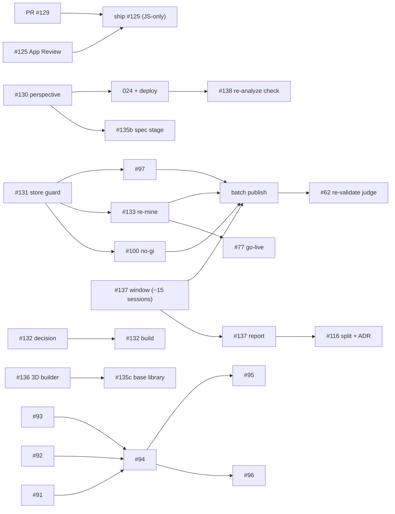

# Backlog plan — milestones and parallel workstreams

_Planned 2026-11-04 from every open issue (28) and open PR (1) in `srjt/flowlog`.
Re-plan when a milestone's exit criteria are met or a decision below changes._

## Who can do what

The backlog splits by **where the work can physically run**, not just by topic:

| owner | can do | cannot do |
| --- | --- | --- |
| **Cloud agent** | code + tests + docs in this repo, web research | reach the local review stores (`~/flowlog-records*`), the instructionals, the frozen baseline, Gemini mining credit, production Supabase |
| **Mac agent** | mining, dry-run publishes, judge runs, production queries — anything needing the local stores or credit | interactive Apple auth, a real recording |
| **You** | decisions, real recordings on device, deploys (`supabase db push`, `functions deploy`, OTA/EAS), sending outreach, recruiting reviewers, merging | — |

## Constraints that shape the order

1. **The Pro-model measurement window (#137) is the pacing item.** It needs ~15 real
   Sessions (~a month at the current ~14/30 days). The findings log (#139) shows
   that every wrong conclusion so far came from measuring two changes at once. So,
   **during the window, nothing changes the coaching path**: no prompt, grounding
   selection or model changes, and (recommended) no live corpus publishes. Mining
   and dry-runs carry on, and the publish waits until the window closes.
   #125, #130 and #131 are all safe inside the window: none of them changes a Cue.
2. **#131 comes before any publish.** Today `publish.sh` defaults to
   `~/flowlog-records` (1,874 records), not the live corpus (`-local-all`, 5,574).
   #97's own instructions (`publish.sh` with defaults) would merge the wrong store
   over production. #97, #100 and #133 all wait on #131.
3. **Re-mine before reviewers vote.** #133 re-mints the ids that votes attach to.
   At zero votes that costs nothing; after go-live it costs reviewers' work. So the
   order is #131 → #133 → #77 go-live.
4. **Migration numbers are taken in merge order, never reserved ahead.**
   `supabase db push` refuses a migration whose number sorts below one already
   applied (without `--include-all`), so a reserved gap becomes a trap.
   Assigned so far: `024` = #130 (PR #142) · `025` = #135 phase b (PR #149).
   #132 takes the next free number when it's built. Two open branches that
   both add a migration: the second to merge renumbers.
5. **Hot files are serialized.** `supabase/functions/process-session/index.ts` and
   `src/pipeline/FlowlogPipeline.ts`: #130 first, the #135 spec stage after it, never
   at the same time. `CLAUDE.md`: only #125 edits it in M1.
6. **Shipping stays JS-only** (no `app.json` version bump). Merge PR #129 before
   comparing fingerprints for the #125 ship decision.
7. **`feat/cue-image-generation` has no merge base with `master`**, and it carries
   the retired generative code (#10 decision 9). #135 salvages `scripts/issue18/`
   by copying files and never merges the branch.

## Milestones

### M1 — Ship-safe foundations _(start now; everything parallel)_

| issue | what | owner | workstream |
| --- | --- | --- | --- |
| #125 | App Review 2.5.19: bench web-only, route inventory + test, App Review doc, OTA rule, CLAUDE.md corrections | Cloud agent | Release |
| PR #129 | Exclude `.gitignore` from the native fingerprint | You (review + merge) | Release |
| #131 | Publish guard (live-store coverage, refuse below threshold, explicit override) + canonical store as config | Cloud agent (code) → Mac agent (verify dry-run on real store) | Corpus |
| #130 | Persist Extraction perspective on the Session: migration 024, 4 write paths, client mirror, review-tool inference | Cloud agent → You (apply 024, deploy function) | Pipeline integrity |
| #137 | **Open the measurement window**: keep recording; nothing on the coaching path changes | You | Coaching quality |
| #93 | Smoothcomp API research → `docs/research/smoothcomp-api.md` (the earlier research never landed) | Cloud agent | Competition Stats |
| #92 | Send the jiujitsu.net outreach (both drafts are in the issue comments) | You | Competition Stats |
| #1 | Triage: pick option 1 / 2 / 3 (see Decisions) | You | Product |

**Exit:** #125, #130 and #131 are merged; 024 is applied and `process-session` is
deployed; the #125 fix has shipped (OTA or build, per the fingerprint check); #129
is merged.

### M2 — Prove it in production _(runs inside the #137 window)_

| issue | what | owner | workstream |
| --- | --- | --- | --- |
| #138 | Re-analyze exercise on a real Session, including the declined case. Run it **after #130 deploys**, so one exercise also checks that perspective is written on both Re-analyze paths | You (+ agent reads the rows) | Pipeline integrity |
| #97 | Mine 3 GFF volumes (smallest; first real use of the #131 guard) | Mac agent | Corpus |
| #133 | Snapshot the store, then re-mine the volumes with unscoped absolutes using `--force`; collisions must stay 0 | Mac agent | Corpus |
| #100 | Mine 7 Gordon Ryan no-gi titles (#99 is resolved); re-check `k-guard-bottom` from the miner's output | Mac agent | Corpus |
| #1 | Build half A: compute a recurring Weakness → Trends + digest Leak | Cloud agent | Product |
| #132 | Decide where verdicts are stored, then re-spec as `ready-for-agent` | You | Coaching quality |
| #91 | Positioning grill (better after #93's findings) | You | Competition Stats |

All mining in M2 stops at **dry-run publish**, leak check clean, staged in the
canonical store.

**Exit:** #138 is closed or its defects are ticketed; #97, #133 and #100 are staged
and dry-run clean; the #137 window has reached ~15 Sessions.

### M3 — Corpus refresh + certification go-live _(window closed)_

| issue | what | owner | workstream |
| --- | --- | --- | --- |
| #137 | Report: model per attempt, fallback count, restatement rate (a human read), length vs median 22 / max 25, a recommendation on the cap | Mac agent + You | Coaching quality |
| — | **Before any publish once votes exist:** stop the REST upload in `publish-cli.ts` from sending `contested`. With merge-duplicates it resets the flag that migration 014 derives from votes. Found during #131 (PR #143) | Cloud agent | Corpus |
| — | **One batch publish** of #97, #133 and #100 via `flowlog-publish`, with the leak scan extended to Gordon Ryan series names; re-measure no-gi availability as *availability*, not coverage | Mac agent | Corpus |
| #77 | Go-live: recruit black belts, cast the first real votes, verify vote upsert / RLS / trigger against a live session. The code is complete per #139 | You | Certification |
| #132 | Build operator verdicts (next free migration number if it's a table) | Cloud agent | Coaching quality |
| #1 | Build half B: feed the Weakness into coaching `dominantWeakness`. This is a coaching-path change, so bump `pipeline_version` | Cloud agent | Product |

**Exit:** the corpus is published; at least one record is certified by real votes;
#137 is closed with a recommendation.

### M4 — Grounding & judging upgrades _(needs M3's clean baseline)_

| issue | what | owner | workstream |
| --- | --- | --- | --- |
| #116 (split) | **New ticket:** don't ground on co-mentioned positions when `target_position_id` is null (the submission case, 3/16 grounded Sessions). Cheap, one condition, bumps the pipeline version | Cloud agent | Coaching quality |
| #116 | ADR for semantic retrieval, once the lexical baseline on 1.2.0+ has accumulated; ranking stays in TypeScript, embedding model id stored per row | You + agent | Coaching quality |
| #62 | Re-validate the judge against the expanded corpus (how many of the 36 cues are judged grounded now, against 6 before?). Gate releases only if it clears ≥12/17 and ≤2/11 | Mac agent | Coaching quality |

## Long-running tracks _(independent of M1–M4)_

**Cue visualization (map #10)**

| issue | what | owner | gate |
| --- | --- | --- | --- |
| #136 | BJJ 3D Position Builder prototype (separate Vite + Three.js project, not the Expo app) | You + agent | none; start any time |
| #135 a | Port grammar / keypoints / validator / renderer + `CueDiagram` from `scripts/issue18/` into tested `src/` modules (new files only) | Cloud agent | parallel-safe now |
| #135 b | Post-gate spec stage in the pipeline + edge function, migration 025. **PR #149**, stacked on #142 + #144; inert until phase c | Cloud agent | merge after #142 and #144 |
| #135 c | Base-library content (~20 positions) | — | blocked on #136 |
| #15, #24, #25 | Parked; #24 and #25 are largely superseded by the 3D direction | — | revisit or close after #136 |

**Competition Stats discovery (map #90).** Decisions only, no code:
#93 (agent) ∥ #92 (you) ∥ #91 (grill) → #94 data-source strategy → #95 stats/UI
prototype ∥ #96 identity-linking prototype.

## Workstreams at a glance

| workstream | M1 | M2 | M3 | M4 |
| --- | --- | --- | --- | --- |
| Release | #125, #129 | — | — | — |
| Pipeline integrity | #130 | #138 | — | — |
| Corpus | #131 | #97 → #133 → #100 (staged) | batch publish | — |
| Coaching quality | #137 window opens | #132 decision | #137 report, #132 build | #116 split, #116 ADR, #62 |
| Certification | — | — | #77 go-live | — |
| Product | #1 decision | #1 half A | #1 half B | — |
| Cue visualization | #135 a, #136 | #135 b | — | #135 c (if #136 lands) |
| Competition Stats | #93, #92 | #91 | #94 | #95, #96 |

## Decisions _(settled 2026-11-04)_

1. **The coaching path is frozen during the #137 window.** The freeze covers live
   corpus publishes: mine and dry-run during the window, then publish once at close.
   Cost accepted: #133 and #100 reach production about a month later.
2. **#1 is option 2**: compute the recurring Weakness client-side in
   `computeTrends`, in two halves. Half A (Trends + digest Leak) goes in M2.
   Half B (coaching input) goes in M3, after the window, because it changes the
   coaching prompt.
3. **#132 verdicts live in a server-only table** (migration 025), locked down like
   `session_prompts`. It is the only option that lets verdicts reach the
   per-record signal, which the issue calls the highest-value half.
4. **Each issue gets one branch and one PR**, so each lands and deploys on its own.

## Housekeeping _(no code; do whenever)_

- **#139:** a reference, not work. Move it to a `docs/` findings file and close it, or pin it.
- **#77:** the acceptance criteria look met in code (tiebreak ranking,
  `contested`/`rejected` excluded, prioritized queue, serving text only). Tick them
  and keep the issue open only for the live go-live.
- **#62:** its native blocker #67 is closed, but the real blocker (the judge fails
  its bar) remains. Update the blocked-by note.
- **#30:** fill in Decisions-so-far for the closed children (#57–#61, #99, #102,
  #114, #117, #119, #121, #124). Its live frontier is now #62, #116, #132, #137.

## First parallel batch _(file sets are disjoint)_

| agent | issue | touches |
| --- | --- | --- |
| A | #125 | `app/review/index.tsx`, a new route-inventory module + test, `tests/unit/reviewScreen.test.tsx`, a new App Review doc, `docs/TESTFLIGHT.md`, `CLAUDE.md` |
| B | #131 | `scripts/mining/*`, `tests/unit/publish.test.ts`, `.claude/skills/flowlog-{mine,publish}/` |
| C | #130 | `supabase/migrations/024_*`, `process-session/index.ts`, `FlowlogPipeline.ts`, `src/types/session.ts`, storage providers, `scripts/admin/*`, related tests |
| D | #93 | `docs/research/smoothcomp-api.md` |
| E _(optional)_ | #135 a | new files under `src/` only; no pipeline wiring |

Each one runs `npm test`, `npm run typecheck` and `npm run lint` before its PR.
